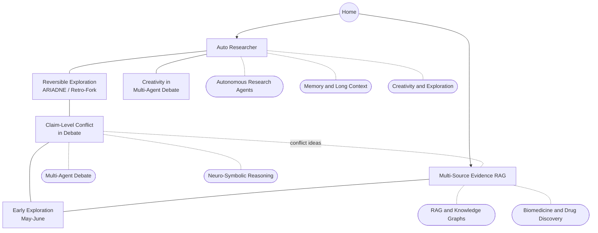

# PhD Research - Home

> [!summary] Start here
> This vault holds **everything from the Notion page "Phd research plan"** (May to October 2026), organized as a graph of **projects, topics, papers and reports**. Meetings are not nodes: their content is stored inside the project and topic notes, by date. There are **two active projects**: the **[[Auto Researcher]]** (an Arbor-based autonomous research agent) and the **[[Multi-Source Evidence RAG]]** (KG + PubMed evidence system for drug side effects, the BC Children project). Everything else is linked to them.

**Last update from Notion:** 23 Oct 2026.

## What to open first

1. [[01 Now and Next]] - what to do this week, for each project
2. [[Auto Researcher]] - project hub
3. [[Multi-Source Evidence RAG]] - project hub
4. [[02 Timeline]] - the whole story, month by month
5. [[03 Ideas Inbox]] - all my own ideas in one place

## Map

## Projects

| Project | Status | Hub | Next step |
|---|---|---|---|
| **Auto Researcher** | active - writing paper | [[Auto Researcher]] | make the introduction clearer; choose baselines and better tasks |
| **Multi-Source Evidence RAG** | active - starting experiments | [[Multi-Source Evidence RAG]] | run experiments on BioASQ list questions vs 5 baselines |
| Creativity in Multi-Agent Debate | paused (Aug 2026) | [[Creativity in Multi-Agent Debate]] | lessons used in Auto Researcher |
| Claim-Level Conflict in Debate | paused (Jul 2026) | [[Claim-Level Conflict in Debate]] | ideas used in the contradiction layer |
| Reversible Exploration (ARIADNE, Retro-Fork) | merged into Auto Researcher | [[Reversible Exploration (ARIADNE and Retro-Fork)]] | - |
| Early Exploration | done (May-June 2026) | [[Early Exploration (May-June 2026)]] | - |
| GC-EndoGaussian paper | accepted, camera-ready | [[GC-EndoGaussian Paper]] | - |

## Topics (concept hubs)

- [[Autonomous Research Agents]]
- [[Multi-Agent Debate]]
- [[RAG and Knowledge Graphs]]
- [[Creativity and Exploration]]
- [[Memory and Long Context]]
- [[Agent Architectures and Frameworks]]
- [[Neuro-Symbolic Reasoning and Argumentation]]
- [[Biomedicine and Drug Discovery]]
- [[Benchmarks and Datasets]]
- [[Evaluation and Metrics]]
- [[Generative Models and Sampling]]
- [[Skills and Tools]]

## Folders

| Folder | What is inside |
|---|---|
| `1 Projects` | project hubs, project notes and the two meeting logs (written for this vault) |
| `2 Topics` | concept hubs that connect papers and projects (they also hold meeting notes about the topic) |
| `3 Papers` | one note per paper or literature review (from Notion) |
| `4 Reports` | experiment reports, proposals, method notes (from Notion) |
| `5 Learning` | courses, tools, background knowledge |
| `6 Notion Categories` | the original Notion categories, each with its list of notes |
| `attachments` | images from Notion |
| `_templates` | templates for new notes |

## Useful lists

- [[04 Decisions Log]] - what was decided and when
- [[05 People]] - who is who
- [[06 Glossary]] - short definitions in simple words
- [[07 Files Index]] - all PDF / Word / other files that are stored in Notion
- [[08 How to Use This Vault]] - how to work with Obsidian here

## Meetings

Meetings are **not separate notes**. Their content was split by subject and put into the project and topic notes, with the date and a link to the Notion page:

- [[AR - Meeting Log]] - all meeting notes about the Auto Researcher
- [[MS - Meeting Log]] - all meeting notes about the Multi-Source project
- Older meetings (May-August) are in the "Notes from meetings" section of [[Early Exploration (May-June 2026)]], [[Claim-Level Conflict in Debate]], [[Reversible Exploration (ARIADNE and Retro-Fork)]], [[Creativity in Multi-Agent Debate]] and of the topic notes
- Daily plans: [[01 Now and Next#Daily log]]
- All dates in one place: [[02 Timeline]]

> [!note] Original source
> Notion page: [Phd research plan](https://app.notion.com/p/Phd-research-plan-7d6d68da32f08241b8300151dc389c24). The top page also has the file **Multi-Agent LLM Systems_ Verified Top-Tier Literature Review (2024-2026).pdf** (see [[Review - Multi-Agent LLM Systems 2024-2026]]).
