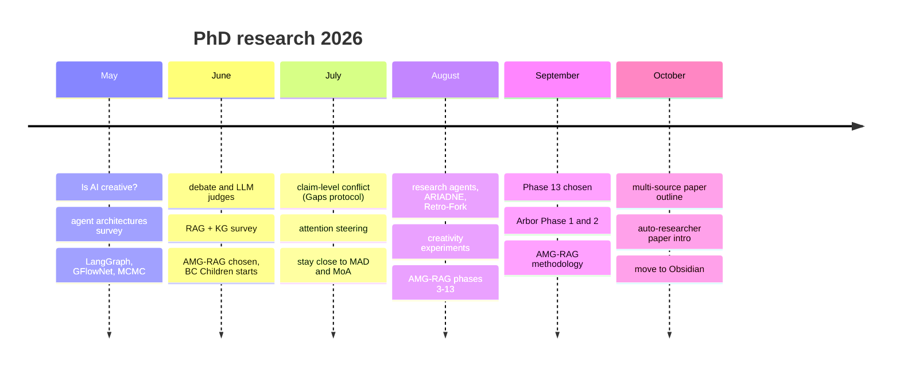

# Timeline

> [!summary] In short
> The whole research story from May to October 2026, month by month. Meetings are not separate notes: a meeting link opens the dated entry inside the project or topic note that holds its content.

## May 2026 - starting point

- **11 May** - first summer meeting: creativity by whole-sequence prediction; MoE expert reuse. [[Early Exploration (May-June 2026)#2026-05-11 Weekly Meeting (Summer 1)|2026-05-11 Weekly Meeting (Summer 1)]]
- **12 May** - plan: mini survey, base architecture, a real scientific question, learn LangChain / LangGraph. [[Early Exploration (May-June 2026)#2026-05-12 One-on-One|2026-05-12 One-on-One]]
- **13 May** - MindMap paper. [[MindMap - KG Prompting for LLMs]], [[Early Exploration (May-June 2026)#2026-05-13 Disease Detection Meeting|2026-05-13 Disease Detection Meeting]]
- **14-17 May** - agent architectures: [[Virtual Lab]], [[ReAct]], [[Plan-and-Execute]], [[Reflexion]], [[Tree of Thoughts and Graph of Thoughts]], [[CodeAct]], [[Multi-Agent Debate - First Notes]], [[ChemCRAFT]]. Talk: [[Agent Architectures and Frameworks#2026-05-14 Explore CS Talk - Confucius Framework|2026-05-14 Explore CS Talk - Confucius Framework]]
- **19 May** - report on agentic architectures. [[Early Exploration (May-June 2026)#2026-05-19 One-on-One (Report)|2026-05-19 One-on-One (Report)]]
- **21 May** - talk: [[Agent Architectures and Frameworks#2026-05-21 Explore CS Talk - PINC|2026-05-21 Explore CS Talk - PINC]]
- **25-26 May** - [[MAPoRL]], [[MCMC - Markov Chain Monte Carlo]], SAGA; "how creative are LLMs". [[Creativity and Exploration#2026-05-26 One-on-One|2026-05-26 One-on-One]]

## June 2026 - debate, RAG and the BC Children project

- **1-2 Jun** - group meeting on logical reasoning; BC Children meeting planned for 4 June. [[Neuro-Symbolic Reasoning and Argumentation#2026-06-01 Weekly Group Meeting|2026-06-01 Weekly Group Meeting]], [[Early Exploration (May-June 2026)#2026-06-02 One-on-One|2026-06-02 One-on-One]]
- **4 Jun** - [[MAD for LLM Judges (Adaptive Stability)]]
- **8 Jun** - [[GFlowNet Foundations]]
- **9 Jun** - 5 debate papers; RAG study; **AMG-RAG chosen** as closest to our approach. [[Multi-Agent Debate#2026-06-09 One-on-One|2026-06-09 One-on-One]]
- **11-13 Jun** - RAG + KG surveys; state of the art in MAD. [[Review - Stance-Aware KG Medical Fact Verification]], [[Review - State of the Art Multi-Agent Debate]]
- **16 Jun** - SAGA run with gpt-mini; KAG; Compute Canada guide. [[Early Exploration (May-June 2026)#2026-06-16 One-on-One|2026-06-16 One-on-One]], [[How to Start Compute Canada]]
- **23 Jun** - neuro-symbolic debate papers; AMG-RAG paper review. [[Multi-Agent Debate#2026-06-23 One-on-One|2026-06-23 One-on-One]]
- **25-29 Jun** - [[Review - Neuro-Symbolic Multi-Agent Debate]], [[ArgLLM]], [[MArgE]], [[MAD-Logic]], [[Debate on Graph (DoG)]]
- **30 Jun** - LangGraph course done; [[PASTA - Attention Steering|PASTA]], [[Self-Anchor (ATAR)]]. [[Memory and Long Context#2026-06-30 One-on-One|2026-06-30 One-on-One]]

## July 2026 - claim-level conflict, then MAD + MoA

- **2-9 Jul** - [[Review - MAD Benchmarks for Complex Tasks]], [[Review - Attention by Highlighting]], [[SPA - Selective Prompt Anchoring|SPA]]
- **6 Jul** - double-blind submission notes. [[GC-EndoGaussian Paper#2026-07-06 Vision Paper - Anonymous Submission Notes|2026-07-06 Vision Paper - Anonymous Submission Notes]]
- **7 Jul** - **Gaps protocol** (claim-level conflict proposal) and reading list; meeting with Youjen about a KG idea. [[Claim-Level Conflict in Debate#2026-07-07 One-on-One|2026-07-07 One-on-One]], [[Gaps Protocol - Claim Conflict Proposal]]
- **14-21 Jul** - baselines: [[SMADE-IE]], [[ReConcile]], [[MACI - Moderator with Two Dials|MACI]], [[MoA - Mixture-of-Agents|MoA]], [[Du et al. - Multiagent Debate]]; ran the BC Children baseline. [[Claim-Level Conflict in Debate#2026-07-14 One-on-One|2026-07-14 One-on-One]], [[Claim-Level Conflict in Debate#2026-07-21 One-on-One|2026-07-21 One-on-One]]
- **22 Jul** - progress report. [[PhD Progress and Literature Report (July 2026)]]
- **26 Jul** - [[AlphaEvolve]]
- **27 Jul** - **decision: stay close to MAD and MoA**; ARIADNE 2-page proposal. [[Reversible Exploration (ARIADNE and Retro-Fork)#2026-07-27 One-on-One|2026-07-27 One-on-One]]

## August 2026 - research agents, creativity, AMG-RAG phases

- **1-6 Aug** - benchmarks: [[GENEDISCO]], [[RE-Bench]], [[ALE-Bench]], [[BioML-bench]], [[BixBench]], [[Biomni - General Biomedical Agent|Biomni]], [[AIDE - ML Engineering as Code Search|AIDE]]
- **4 Aug** - big related-work review; gap = decision-level rollback from valid failure (ARIADNE-Bio). [[Reversible Exploration (ARIADNE and Retro-Fork)#2026-08-04 One-on-One|2026-08-04 One-on-One]]
- **5 Aug** - GC-EndoGaussian camera-ready answers. [[GC-EndoGaussian - Response to Reviewers]]
- **11-12 Aug** - Reversible Exploration and Retro-Fork documents; [[Mage - Memory as Execution State|Mage]], [[EviGraph - Evidence-Guided Research Agents|EviGraph]], **[[Arbor - Hypothesis Tree Refinement|Arbor]]**
- **13-14 Aug** - creativity benchmarks: [[EscapeBench]], [[MUTATE - Divergent Thinking Benchmark|MUTATE]], [[PMO - Practical Molecular Optimization|PMO]], [[SMDD-Bench]], [[BioDiscoveryAgent]]. [[Creativity in Multi-Agent Debate#2026-08-13 One-on-One (13 and 20 Aug)|2026-08-13 One-on-One (13 and 20 Aug)]]
- **19-20 Aug** - **creativity experiments 1 and 2**. [[Creativity Experiments - Key Findings]]
- **25 Aug** - AMG-RAG Phase 9; drug repurposing benchmarks; quality-diversity on Arbor idea. [[AR 7 - Meeting Log#2026-08-25 One-on-One|2026-08-25 One-on-One]], [[AMG-RAG Phase 9 - How It Works]]
- **27-28 Aug** - AMG-RAG phase reports and Phase 11 method note. [[AMG-RAG Phase Evolution Report]], [[AMG-RAG Phase 11 - Method Note]]

## September 2026 - results and Arbor phases

- **1 Sep** - **Phase 13 chosen** as main research configuration; baselines for idea agents; DrugMechDB inverted idea. [[AR 7 - Meeting Log#2026-09-01 One-on-One|2026-09-01 One-on-One]], [[AMG-RAG Final Conclusion]]
- **8 Sep** - [[MedRAGChecker]], [[Contradictions in Context - Medical RAG]]; methodology writing; proposal. [[MS - Meeting Log#2026-09-08 One-on-One|2026-09-08 One-on-One]]
- **21 Sep** - **Arbor Phase 1 vs default** results; AMG-RAG architecture updated. [[AR 7 - Meeting Log#2026-09-21 One-on-One|2026-09-21 One-on-One]]
- **29 Sep** - Phase 2 and Claude Code baseline; AMG-RAG repo and trajectory; PGxQA etc. [[AR 7 - Meeting Log#2026-09-29 One-on-One|2026-09-29 One-on-One]]

## October 2026 - writing

- **7 Oct** - multi-source paper outline, datasets and baselines. [[MS - Meeting Log#2026-10-07 BC Children Meeting|2026-10-07 BC Children Meeting]]
- **14 Oct** - Kaggle results for four scaffolds; related work notes; intro outline. [[AR 7 - Meeting Log#2026-10-14 One-on-One|2026-10-14 One-on-One]], [[AR 6 - Paper Draft (Introduction)]]
- **15-19 Oct** - baselines final for multi-evidence; Overleaf started for the auto-researcher intro. [[01 Now and Next#Daily 2026-10-15 to 2026-10-19|Daily 2026-10-15 to 2026-10-19]]
- **20 Oct** - intro done; exploration vs expectation; plan to move to Obsidian. [[AR 7 - Meeting Log#2026-10-20 One-on-One|2026-10-20 One-on-One]]
- **21-23 Oct** - LLM/attention lectures, 5 new ideas, Think-on-Graph v3, plan for multi-source experiments. [[01 Now and Next#Daily 2026-10-20 to 2026-10-23|Daily 2026-10-20 to 2026-10-23]]
