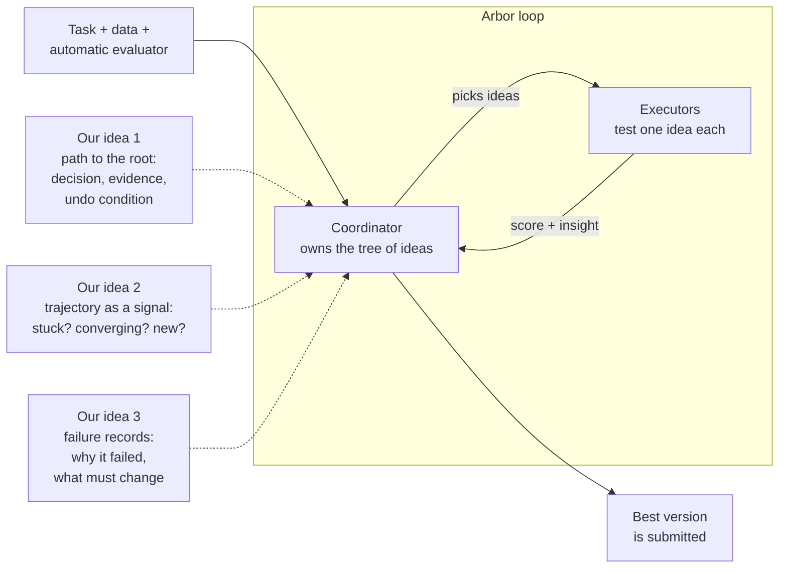

# AR 0 - Start Here

> [!summary] In short
> We are building a research agent that works alone for days on a task with an automatic score: it proposes ideas, codes them, tests them, keeps what works and drops what does not. We build on [[Arbor - Hypothesis Tree Refinement|Arbor]]. Our change is **what the agent remembers**: for each idea, the chain of decisions that led to it, the evidence behind each decision, and the condition that would undo it.

**Status (27 Oct 2026):** writing the paper. The introduction is drafted. First experiments on one Kaggle task are done. Still open: better evaluation tasks (the Kaggle task is not good enough) and the final baselines.

**Next steps:** [[01 Now and Next#Auto Researcher]] · **Open decisions:** [[AR 5 - Open Questions]]

---

## 1. Read the notes in this order

| # | Note | What you find there |
|---|---|---|
| 0 | **AR 0 - Start Here** (this note) | the project on one page, a glossary, all linked papers |
| 1 | [[AR 1 - Problem and Method]] | the four problems, our three ideas, a worked example, what we tried |
| 2 | [[AR 2 - Experiments and Results]] | what we ran and what we saw |
| 3 | [[AR 3 - Benchmarks]] | tasks we can evaluate on |
| 4 | [[AR 4 - Related Work and Baselines]] | the closest systems, how we differ, which baselines to run (this overview and one note per system are in the folder **AR 4 - Related Work**) |
| 5 | [[AR 5 - Open Questions]] | open decisions and scientific questions: planned work, related-work answers, and prior experiments |
| 6 | [[AR 6 - Paper Draft (Introduction)]] | the paper text so far |
| 7 | [[AR 7 - Meeting Log]] | every meeting about this project, by date |

## 2. The project in one picture

## 3. Our three ideas in one line each

1. **Path to the root (main contribution).** Each agent loads only the chain of decisions from its current idea back to the start, not the whole history. Each step stores the decision, its evidence and its **undo condition**.
2. **Trajectory as a control signal.** All paths together form a log of the run. The loop reads it to see when a branch is stuck, when two agents chase the same idea, and how new an idea is.
3. **Failure records.** When an idea fails, we store why and what would have to change, so the idea can be refined or reopened later instead of being lost. (This part is still weak.)

We also give every new idea a **shared memory** of findings and failures, but we do not claim it (Kosmos does something similar). Details and a worked example: [[AR 1 - Problem and Method]].

## 4. Results so far in two lines

- **September, Phase 1 vs Arbor default:** the same final score (0.322 vs 0.325), but reached faster, with about half the hours, and 3-5 levels deep instead of 2.
- **October, four scaffolds:** ours was best in the first cycles; Claude Code won at the end by about +0.03. Our blocking rule made agents less ambitious.

Details: [[AR 2 - Experiments and Results]].

## 5. Glossary

| Term | Meaning in this project |
|---|---|
| **Coordinator** | The long-lived Arbor agent that owns the tree of ideas and decides what to test next. |
| **Executor** | A short-lived agent that tests one idea in its own git worktree and reports a score and an insight. |
| **Node / idea** | One hypothesis in the tree, with its code, score and insight. |
| **Cycle** | One pass of the loop: pick ideas, test them, update the tree. |
| **Round** | A group of cycles (12 in our runs) that ends with a submission. |
| **Dev score / held-out score** | The score the agent sees while working / a separate score used before merging or submitting. |
| **Path to the root** | The chain of decisions from the current idea back to the start of the run. |
| **Undo condition** | For one decision: the evidence that would show it was wrong, so it should be reopened. Older notes also say "overturn condition" or "reopening condition". |
| **Trajectory** | The append-only log of all paths in the run (plan, code, result, revision). |
| **Failure record** | Why an idea failed and what would have to change for it to work. |
| **Shared memory** | A summary of findings and failures given to every new idea (we use it, we do not claim it). |
| **Blocking** | Pausing an idea until its undo condition becomes true. |
| **Phase 1 / Phase 2** | Our two versions built on top of Arbor (September 2026). |

## 6. How we got here

```mermaid
flowchart LR
  A[May: Is AI creative?<br/>agent architectures] --> B[June: multi-agent debate<br/>and LLM judges]
  B --> C[July: claim-level conflicts<br/>Gaps protocol]
  C --> D[27 July: stay close to<br/>MAD and MoA]
  D --> E[Aug: research agents<br/>ARIADNE, Retro-Fork]
  E --> F[Aug: creativity experiments<br/>in debate]
  F --> G[25 Aug: quality-diversity<br/>on Arbor idea]
  G --> H[Sep: Phase 1 and 2<br/>on Arbor]
  H --> I[Oct: paper writing]
```

- [[Early Exploration (May-June 2026)]]
- [[Claim-Level Conflict in Debate]]
- [[Reversible Exploration (ARIADNE and Retro-Fork)]]
- [[Creativity in Multi-Agent Debate]]

## 7. All notes linked to this project

### Drafts (1)

- [[AR 6 - Paper Draft (Introduction)]] - Draft of the auto-researcher paper introduction: levels of scientific agents, our level, limits (long context, planning, memory, exploration), closest systems and our...

### Papers by role (37)

#### Our base system (1)

- [[Arbor - Hypothesis Tree Refinement]] - Arbor keeps the whole research state in a persistent hypothesis tree. A long-lived coordinator manages the tree; short-lived executors test one hypothesis each in a...

#### Baselines we can run (6)

- [[AIDE - ML Engineering as Code Search]] - AIDE searches over whole Python scripts with a solution tree. No shared knowledge, no merging. Close to our idea and a search baseline.
- [[AIRA-dojo - Search Policies and Operators]] - Meta's study on MLE-bench: an agent = search policy + operators. Better operators mattered more than greedy vs MCTS vs evolution. Agents overfit to validation.
- [[Autoresearch (Karpathy)]] - Greedy edit, train, keep-or-reset loop with git as memory. Simple and popular baseline.
- [[ML-Master 2.0 - Hierarchical Cognitive Caching]] - Three memory levels (traces, phase summaries with reasons, cross-task wisdom); 56.44% medals on full MLE-bench. Strongest memory rival.
- [[MLEvolve - Monte Carlo Graph Search]] - UCT tree with cross-branch reference edges and a success/failure memory; 65.3% any medal on full MLE-bench in 12 h.
- [[The AI Scientist (v1 and v2)]] - Sakana's idea-to-paper agent; v2 uses a staged best-first tree search and keeps only the best node per stage. Nature 2026.

#### Closest to our ideas (must cite) (6)

- [[ScienceFlow - Re-Anchoring Long-Horizon Agent]] - Continue or jump back to archived checkpoints with their evidence; 70.22% on full MLE-bench. Closest to reopening old ideas.
- [[AiScientist - File-as-Bus Long-Horizon Engineering]] - Orchestrator plus a shared File-as-Bus workspace with append-only logs; 81.82% on MLE-bench Lite. No code.
- [[Failure Registry - Recovering Wasted Compute]] - Plug-in failure registry with banned patterns, proven fixes and backtracking; AIDE golds 22 to 38.
- [[DeepScientist - Findings Memory]] - Bayesian-optimization research loop with a Findings Memory of all ideas, failed ones too; month-long runs (ICLR 2026).
- [[Mage - Memory as Execution State]] - Memory for long-horizon agents as execution state: one layer for raw step data, one layer for summaries. Critical of plain RAG memory.
- [[EviGraph - Evidence-Guided Research Agents]] - Graph of evidence with long and short memory and rollback to a better earlier state. Uses the graph for evidence, not for thinking steps. Not very similar to our work.

#### Other research-agent systems (8)

- [[AI-Researcher and Scientist-Bench]] - Paper-to-paper pipeline with an advisor agent; Scientist-Bench of 22 papers, judged by LLMs (NeurIPS 2025).
- [[Kosmos - AI Scientist with World Model]] - Long runs with a shared structured world model; keeps conclusions, not paths. Commercial, no code.
- [[ScientistTwo]] - Google system that improves published ML methods (86 of 107 wins); Good / Bad / Engineer triage; about $3.8k per task, no code.
- [[AutoResearchClaw]] - 23-stage idea-to-paper pipeline with PROCEED / REFINE / PIVOT and a lesson store. Judged by an LLM.
- [[Google AI Co-Scientist]] - Generate, debate, Elo-rank and evolve biomedical hypotheses (Nature 2026). No public code; does not run its own experiments.
- [[Robin - Drug Repurposing Agent]] - FutureHouse literature and data-analysis agents for drug repurposing; found ripasudil for dry AMD (Nature 2026). Needs the paid Edison API.
- [[ResearchAgent - Iterative Idea Generation]] - Problem, method and experiment design from a core paper, refined by 15 reviewer agents. No experiments (NAACL 2025).
- [[MOOSE-Chem - Chemistry Hypothesis Rediscovery]] - Chemistry hypothesis rediscovery from inspiration papers with evolution and beam search (ICLR 2025). No experiments.

#### Biomedical agents (2)

- [[Biomni - General Biomedical Agent]] - Biomni builds a large biomedical action space (tools, databases, software) from 2,500 papers. Good for medical baselines.
- [[BioDiscoveryAgent]] - Stanford agent that designs gene perturbation experiments. Main metric: cumulative hit ratio over rounds.

#### Search, reasoning and exploration (background) (4)

- [[FML-bench - Search Dynamics of Research Agents]] - 18 ML research tasks to compare the search behavior of six agents. Early gains predict the final score; scattered search does not help. AdaptiveSearch (greedy, then branch when stuck) is close to our exploration idea.
- [[AlphaEvolve]] - Evolutionary coding agent: LLMs propose program changes, automatic evaluation selects survivors. Creativity comes from a pool of ideas that keeps improving.
- [[Reflexion]] - Actor, evaluator and self-reflection model. The agent learns from verbal feedback stored in memory.
- [[Tree of Thoughts and Graph of Thoughts]] - Reasoning as a tree or a graph of thoughts with generate, refine and aggregate steps.

#### Benchmarks (10)

- [[ALE-Bench]] - Score-based long-horizon algorithm engineering from 40 AtCoder heuristic contests. Results map to human rankings.
- [[BioML-bench]] - 24 end-to-end biomedical ML tasks (drug discovery, imaging, protein engineering, single-cell). Tests full ML pipelines by agents.
- [[BioML-bench - Drug Discovery Tasks]] - The 9 drug discovery tasks of BioML-bench (potency, ADME, toxicity) from Polaris and TDC.
- [[EscapeBench]] - Text-only room-escape games to measure creative intelligence of LLM agents. Top models reach only about 15% progress without hints.
- [[GENEDISCO]] - Benchmark for choosing which genes to test next in costly experiments (active learning for drug target discovery).
- [[GENEDISCO - Creativity View]] - GENEDISCO seen as a creativity test: maximize target discovery rate and model performance.
- [[MUTATE - Divergent Thinking Benchmark]] - Text sandboxes where the obvious solution fails. Measures path-level and action-level divergence of agents. Close to EscapeBench.
- [[PMO - Practical Molecular Optimization]] - Benchmark with 23 molecule objectives and a 10K oracle budget; scores the path too (AUC top-10). Idea: use intermediate rewards in long horizons.
- [[RE-Bench]] - Seven open-ended ML research engineering environments with a scoring function, compared with human experts.
- [[SMDD-Bench]] - 502 medicinal-chemistry tasks over 102 protein targets (pharmacophore, interaction points, scaffold hopping, ...).

### Literature reviews and lists (1)

- [[Review - Creativity Measuring Benchmarks]] - Overview of benchmarks that measure creativity (CreativityBench, MacGyver, DeepMath-Creative, EscapeBench, MUTATE, bio tasks).
