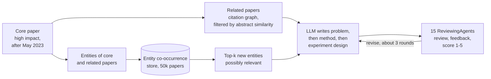

# ResearchAgent - Iterative Idea Generation

> [!summary] In short
> Generates a research idea (problem, method, experiment design) from one core paper, using three knowledge sources like a human researcher: (1) related papers from the citation graph, (2) an **entity co-occurrence store** built from about 50,000 papers that suggests concepts from other fields, and (3) **15 LLM reviewer agents** that score the idea and give feedback for a few rounds of revision. It **never runs experiments**.

**Project:** [[AR 0 - Start Here|Auto Researcher]]  
**Topics:** [[Autonomous Research Agents]], [[Creativity and Exploration]], [[RAG and Knowledge Graphs]]  
**Part of:** [[AR 4 - Related Work and Baselines]] (related work, section 5)  
**Original:** [arXiv 2404.07738](https://arxiv.org/abs/2404.07738) · [PDF](https://arxiv.org/pdf/2404.07738v2) · [GitHub](https://github.com/JinheonBaek/ResearchAgent)

> [!note] Source of these notes
> The method section comes from my own reading notes (27 Oct 2026), checked by Claude against the arXiv PDF. The other sections were written by Claude from the arXiv page, the ACL Anthology paper and the GitHub README.

---

## Paper

- **Title:** *ResearchAgent: Iterative Research Idea Generation over Scientific Literature with Large Language Models.*
- **Authors:** Jinheon Baek, Sujay Kumar Jauhar, Silviu Cucerzan, Sung Ju Hwang.
- **Venue:** NAACL 2025 (long paper).
- **Code:** public. Needs an OpenAI key and the Semantic Scholar API.

## Problem

Generate good research ideas from the literature, not only from the model's memory. All of science does not fit in a context window, so the system must choose what to read.

## Method: three knowledge sources

### 1. Related literature from the citation graph

- Start from one high-impact **core paper** published after 1 May 2023, so it is not in GPT-4's training data. Citation threshold: more than 20 citations (section 4.1; section 3.2 gives a different example, more than 100 citations in 3 months).
- Add the papers linked to it in the **Semantic Scholar citation graph**. A core paper has about 87 references on average, so they are filtered by **abstract similarity** to the core paper.
- The LLM sees only **titles and abstracts**.

### 2. Entity-centric knowledge store (main novelty)

- Run an off-the-shelf entity linker (**BLINK**) over the titles and abstracts of **50,091 papers**.
- Build a sparse **co-occurrence matrix K**: how often each pair of entities appears in the same paper, plus how often each entity appears overall.
- At generation time, take the entities of the core paper and its related papers (call this set $E$). Then retrieve the top-k **new** entities (not already in $E$) that are most probable given $E$.
- **Scoring (Equation 2).** Assume the entities are independent and use Bayes' rule. For a candidate entity $c$:

$$\text{score}(c) = P(c \mid E) \;\propto\; P(c)\prod_{e \in E} P(e \mid c)$$

  Both the conditional probabilities and the prior $P(c)$ are read from the normalized matrix $K$.

> [!warning] Notation
> This is written in my own notation. The paper uses $e_i$ and $e_j$; check the index order against Equation 2 in the PDF.

- **Intuition: cross-pollination.** If "database" often appears together with medical concepts, it can be suggested for a hematology paper even if it never appears in that paper.
- The entities are added to the prompt as **"possibly relevant, not all useful"** inspiration.

### 3. Iterative refinement with ReviewingAgents

- The idea is written in order: **problem → method → experiment design**.
- **15 ReviewingAgents** = 5 criteria × 3 idea parts. Each one is a GPT-4 call with its own prompt (Tables 9-11) that returns a review, feedback and a score from 1 to 5. ResearchAgent then revises the idea.

| Idea part | Criteria |
|---|---|
| Problem | Clarity, Relevance, Originality, Feasibility, Significance |
| Method | Clarity, Validity, Rigorousness, Innovativeness, Generalizability |
| Experiment design | Clarity, Validity, Robustness, Feasibility, Reproducibility |

- The criteria were aligned with human judgment using 10 human-scored examples.
- Scores stop improving after about **three rounds** (the paper tests 0 to 4 rounds).

## Results

- 300 core papers published after May 2023 (computer science 25%, medicine 21%, engineering 13%).
- With GPT-4, scores rose from the plain baseline to the full system: problem 4.20 to 4.52, method 4.03 to 4.28, experiment design 3.92 to 4.18.
- Human-model agreement on pairwise comparisons: 0.71.

## Limits

- Ideas are never tested.
- The entity store only uses titles and abstracts (about 3 entities per paper).
- Weak for theory fields.
- The paper is not fully consistent: it gives two different citation thresholds for core papers, and its prompt templates describe related papers as papers that *cite* the core paper.

## How it relates to my work

- **Similar to:** refining ideas with critique, round after round.
- **Different from my work because:** no execution, no score, no tree.
- **Can I use it as a baseline?** Not on our tasks (there is nothing to run). Only in a side study on idea quality, or as the ideation step inside our agent.

## Ideas it gave me

- **Reviewer agents with fixed criteria** could help our failure-records step: say what must change before an idea is retried.
- **The entity store as a cheap "jumping ideas" generator.** Suggesting concepts that co-occur with the task's concepts in other fields is a simple way to make exploration part of the loop (see [[AR 1 - Problem and Method#8. Exploration vs refinement|exploration vs refinement]]). Concepts we already tried could be read from our trajectory and excluded, the same way ResearchAgent excludes entities that are already present.
