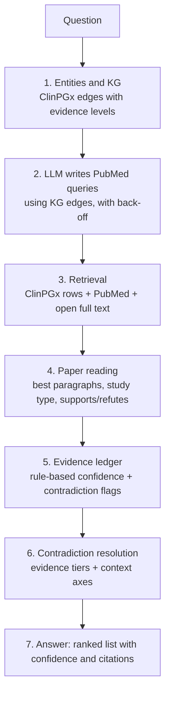

# Multi-Source Evidence RAG

Also called: **BC Children project**, **multi-evidence system**, **AMG-RAG extension**.

> [!summary] In short
> A question answering system for **pharmacogenomics and adverse drug reactions (ADR)** in children. Example question: *"I am a child receiving cisplatin. Which genetic variants make me more likely to lose hearing?"* The system joins **two kinds of sources**: a curated knowledge graph (ClinPGx / PharmGKB) and the scientific literature (PubMed and open full text). It reads papers, keeps an **evidence ledger** with rule-based confidence, and **finds and explains contradictions** between sources. The output is a **list of candidate answers with confidence and citations**, not just a paragraph. It extends [[AMG-RAG - Paper Summary|AMG-RAG]].

**Status (23 Oct 2026):** paper outline done (7 Oct). Baselines and datasets chosen (final decision 15 Oct). Target benchmarks updated (20 Oct). **Next: start experiments with the multi-source system and implement the "trajectory" idea.**

**Main notes of this project**
- [[MS - Method (Pipeline and Ledger)]] - how the system works
- [[MS - Phases and Results]] - all phases from baseline to Phase 13, with numbers
- [[MS - Paper Plan (Baselines and Datasets)]] - outline, baselines, datasets, metrics
- [[MS - Open Questions]] - what to do next
- [[MS - Meeting Log]] - all meeting notes about this project, by date

People: [[05 People#Tulika|Tulika]] (baselines, datasets, architecture talks). See [[05 People]].

---

## 1. The problem in simple words

- An LLM alone gives answers that **sound right but are not supported**. It picks genes that are *plausible* instead of genes with real evidence. In our baseline only **61%** of named genes were really linked to the drug in ClinPGx.
- A curated database (ClinPGx) is precise but can be **old**.
- Live literature search is **new** but brings **noise and contradictions**.
- Papers often **disagree**. Usually the reason is context: different population (children vs adults), cancer type, endpoint, dose, or study type.

## 2. Input and output

- **Input:** a question + a knowledge graph (KG) + literature search.
- **Output:** a list of possible answers (for example gene-drug pairs), each with a **confidence**, **supporting and refuting evidence**, **contradiction flags**, and **citations down to the paragraph**.

## 3. How it works (short)

Details: [[MS - Method (Pipeline and Ledger)]].

## 4. Main results (10 ADR questions, Qwen2.5-14B)

| Phase | Main idea | Key result |
|---|---|---|
| Baseline | LLM only / original AMG-RAG | 50-61% genes valid, no provenance |
| 3 | Ground in ClinPGx | Gene validity **95%** |
| 4 | Add cited PubMed papers | First citable answers; passed false-premise test |
| 8-9 | Search related KG terms together (AND) | On-topic retrieval **54%** |
| 10 | LLM writes free queries, reads paragraphs | On-topic **59%**, no empty searches |
| **11** | **Evidence ledger** | **Best precision 65%**, calibration Spearman **0.721**, contradiction recall **0.95** |
| 12 | More open full text (Europe PMC, Unpaywall) | Full-text coverage 6% to **43%** |
| **13** | **Context-aware contradiction resolution** | **Best research score 4.44**; 22 real conflicts, 3 explained by context, 29 mechanistic downgrades |

**Decision:** Phase 13 is the main research configuration; Phase 11 is the precision and safety control. Future system = hybrid of both. Details: [[MS - Phases and Results]].

## 5. Our view vs AMG-RAG (from the June review)

From [[AMG-RAG - Paper Review Notes]]:
- We also have a KG and a set of documents as input.
- Our query is an **adverse drug reaction** (and maybe a set of candidate genes), not free text.
- We extract evidence from **each document separately**.
- We can use **domain knowledge for confidence**: randomized trial > observational study; more samples = more confidence.
- We must **aggregate many reasoning chains**, one per document. Idea: multi-agent debate with one agent per paper.
- If a paper adds a new category, we update the KG.

## 6. Next steps

See [[01 Now and Next#Multi-Source Evidence RAG]] and [[MS - Open Questions]].

## 7. All notes linked to this project

### Reports and experiments (8)

- [[AMG-RAG Final Conclusion]] - Final conclusion: Phase 13 is the best research configuration (contradiction discovery); Phase 11 stays as the precision and safety control.
- [[AMG-RAG - Role of LLM, KG and Internet]] - Write-up: what parametric LLM knowledge, the curated KG, and internet search each add to ADR question answering. The best system is a hybrid.
- [[AMG-RAG Five Best Answers]] - File only: Five_Best.md (best AMG-RAG answers).
- [[AMG-RAG Phase 11 - Method Note]] - Full method note of Phase 11: knowledge sources, 6-stage pipeline, evidence ledger with rule-based confidence, contradiction flags, results and limitations.
- [[AMG-RAG Phase Evolution Report]] - Story of all AMG-RAG phases from baseline to Phase 13. Phase 11 is most precise; Phase 13 is best for finding and explaining contradictions.
- [[AMG-RAG Phases Comparison Tables]] - All comparison tables: configuration matrix, headline metrics, retrieval precision, search shape, ledger results, calibration and cost.
- [[AMG-RAG Phase 9 - How It Works]] - Phase 9 of AMG-RAG: search related KG entities together as one PubMed AND-query, with back-off, then read open full text.
- [[AMG-RAG Phases Report (Scores)]] - Phase catalogue, scores (on-topic %, grounded %, ClinPGx-valid %, false premise), search shape and genes found per phase.

### Papers (10)

- [[AMG-RAG - Paper Review Notes]] - My review/feedback notes on the AMG-RAG paper (agentic medical KG for QA).
- [[AMG-RAG - Paper Summary]] - AMG-RAG: LLM agents build and update a medical KG from live sources and reason over it. Our multi-source project extends this system.
- [[Contradictions in Context - Medical RAG]] - Shows that medical RAG is not reliable just because papers are relevant: similar papers can disagree. They filter out contradicting papers instead of explaining why.
- [[Debate on Graph (DoG)]] - KG question answering with debate to avoid long reasoning paths and false-positive relations.
- [[DoM - Debate over Mixed-knowledge]] - For incomplete KGs: a KG agent and a text (RAG) agent work in parallel and a judge decides.
- [[GraphCheck]] - Uses a GNN over a KG for fact checking. Ignored for now.
- [[KAG - Knowledge Augmented Generation]] - Combines an expert-made static KG with dynamic knowledge from context. Planning, reasoning and retrieval loop.
- [[MedGraphRAG]] - Graph RAG for medicine with a three-tier KG (patient data, literature, UMLS) and U-Retrieval. Too complex for us.
- [[MedRAGChecker]] - Breaks an answer into claims and checks each claim with NLI on retrieved text and with a biomedical KG (DRKG or BioPortal).
- [[MindMap - KG Prompting for LLMs]] - MindMap: extract path-based and neighbor-based evidence subgraphs from a KG, then let the LLM reason over them. Used as a baseline in the multi-source project.

### Literature reviews and lists (6)

- [[Benchmarks - BC Children QA Candidates]] - Short list of QA benchmarks: PubMedQA, MedQuAD, LiveQA, MedRedQA.
- [[Review - BC Children Related Works]] - Folder page for related work of the BC Children (multi-source) project.
- [[Review - Medical Fact-Verification Bibliography]] - Categorized bibliography (about 55 papers) for stance-aware, KG-grounded, multi-document medical fact verification.
- [[Review - Selected KG and RAG Papers]] - Selected papers that do documents to graph to LLM decision in one pipeline (MedGraphRAG, GraphCheck, AMG-RAG, ...).
- [[Review - Stance-Aware KG Medical Fact Verification]] - Literature review for a system that splits support vs contradict evidence over a dynamic medical KG and gives a confidence score.
- [[Review - State of the Art Multi-Agent Debate]] - Long review of the state of the art in multi-agent debate and KG reasoning (ToG, RoG, ...), benchmarks and SOTA results.

